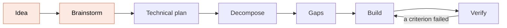

# Epic Flow

**From an idea to verified, tested code. You answer the questions once. It does the rest.**

[](https://code.claude.com/docs/en/plugins)
[](https://github.com/biosphere-labs/epic-flow/releases)
[](https://github.com/biosphere-labs/epic-flow/stargazers)
[](https://github.com/biosphere-labs/epic-flow/commits)
[](LICENSE)

```
/plugin marketplace add biosphere-labs/epic-flow
/plugin install epic-flow@epic-flow
```

## Why

Keep the insight. Delegate the craft. Understand both.

## How it works



You take part in the shaded stages. Everything after them runs unattended, and an independent checker tests each stage's output from the files before the next one starts.

- **One question session, then walk away.** Every open question across every feature is asked up front. Nothing needs your input halfway through.
- **Sequential or parallel, your call.** Before the build, you get both options, each with a time estimate, a risk level and the reasons behind that risk.
- **Nothing waits that doesn't have to.** Work starts the moment its inputs exist. Even a sequential build prepares the next task, tests the last one and writes the acceptance tests while the current task is being built.
- **Plans grounded in your code.** It reads your base branch and follows the libraries and patterns you already use.
- **Specified by example.** Every acceptance criterion carries concrete examples with real values, edge cases included, and those examples become the unit and acceptance tests.
- **Proof, not claims.** Every criterion is tested through its real entry point. The test must then fail with the implementation disabled, and fail again with the entry point cut.
- **Built for big work.** Several features or a whole app at once, ordered by what depends on what, and it can resume any time.
- **Safe with your repo.** Work happens on feature branches in worktrees. It never pushes or opens a PR unless you say so.

## Commands

| Command | What it does |
| --- | --- |
| `/epic-flow:idea` | Parks an idea in seconds |
| `/epic-flow:run` | Takes features through the stages, or runs one stage ("only gaps") |
| `/epic-flow:status` | Shows where every feature is and what to run next |

That's the whole interface: three commands.

**[How it works in detail →](docs/how-it-works.md)**

## What it does on your machine

Epic Flow works through Claude Code's own tools, in the repository you run it in. It has no server, no telemetry and no credentials of its own.

- **Files:** writes its records under `.epic-flow/` and works in git worktrees under `.worktrees/`, which it adds to `.git/info/exclude`.
- **Git:** creates the feature branch you name in delivery (and short-lived branches for parallel groups and acceptance tests), and commits there. It never commits on your base branch.
- **Commands:** runs your project's own type check and tests, `git`, and `scripts/slice.mjs` (a bundled, readable Node script that maps which code calls which). Reads the machine's core count and load (`sysctl`/`nproc`, `uptime`) to size parallel builds.
- **Agents:** starts Claude subagents, through the Workflow tool when available, to do each stage.
- **Network:** `git fetch` when the repository has a remote; a web lookup when a brief names a reference product to follow; `git push` and a pull request only when you said so in delivery.

## Status

This is an early release (0.1.1). MIT licensed. [Privacy policy](PRIVACY.md).
