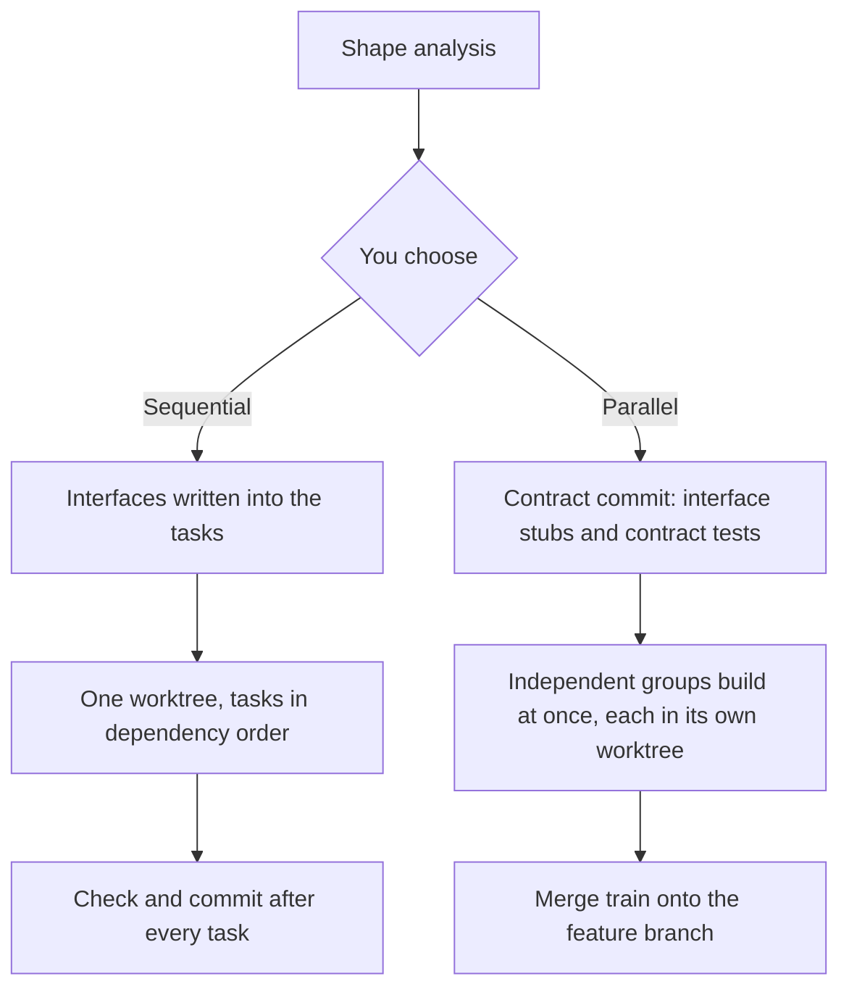

# How Epic Flow works

[← Back to the README](../README.md)

## The stages

| # | Stage | Command | What it produces |
| --- | --- | --- | --- |
| 1 | Stub | `/epic-flow:stub` | Parks an idea in seconds, in your own words, and asks nothing |
| 2 | Brainstorm | `/epic-flow:brainstorm` | An accepted brief: problem, decisions, approach, success, delivery |
| 3 | Technical plan | `/epic-flow:technical-plan` | A plan grounded in your codebase, with numbered acceptance criteria |
| 4 | Decompose | `/epic-flow:decompose` | Self-contained tasks, level by level: modules, then interfaces, then units |
| 5 | Gaps | `/epic-flow:gaps` | Missing tasks found and added, then reviewed by two blind reviewers |
| 6 | Build | `/epic-flow:build` | The code, built sequentially or in parallel |
| 7 | Verify | `/epic-flow:verify` | Every acceptance criterion proven, or the responsible tasks reopened |

Run one stage on its own, or a range of stages over many features with `/epic-flow:run`. The rules every stage follows are in [`conventions.md`](../conventions.md).

## The run

`/epic-flow:run` works in three steps:

1. **Develop.** For each feature, one agent drafts the brief and asks Socratic questions. A second agent, with a fresh context, answers what it can from the code and the records. Two rounds at most.
2. **Question session.** You get every question neither agent could settle, across all features, in one sitting. You also choose delivery (branches, push, PR, time budget) and the build shape.
3. **Unattended.** Technical plan, decompose, gaps, build and verify run without you. Independent features run at the same time. A feature that needs another's result waits for it.

## Questions are answered in a fixed order

Before a question reaches you, the stage tries each of these in order and takes the first that answers it:

1. what you already said
2. the repository
3. a reference product the brief names
4. the platform's default
5. the smaller, reversible option

Each answer goes into `questions.md` with the rule that gave it, so you can overturn any assumption later. Only questions that are genuinely yours reach you: purpose, scope, credentials, and anything only a person can do.

## Sequential or parallel

Before the run starts, Epic Flow analyses each feature: the parts it splits into, which parts need another's result, and the longest chain of dependent tasks. It then offers both shapes, each with three things:

- **A time estimate, as a range.** It comes from how long tasks have taken on your machine, a real timing of your test suite, and the machine's cores and load. Until enough tasks have been timed, it labels the figure as assumed, not measured.
- **A risk level**: low, medium or high.
- **The reasons for that risk.** For example: the model running the build isn't the most capable tier and the work is complex, or two parts may depend on each other in a way it can't confirm.



**Sequential** has one writer at a time. Decompose writes each interface into the task that produces it, and every task that uses it quotes it word for word and runs after it. The order protects the seams, so there's nothing to freeze and nothing to merge. Decompose is faster and the build is simpler.

**Parallel** has several writers at once. Decompose writes every interface between them as compiling code (interface stubs with contract tests) and freezes it in a contract commit before any implementation starts. Writers fill in bodies behind those frozen seams, so two agents can't guess differently about the same interface. Finished groups go through a merge train, and each group is tested on top of the ones ahead of it.

You choose once, up front. If you chose parallel and the real task graph turns out to be one long chain, the build runs sequentially and records why.

## Checks along the way

- **An independent checker after every stage.** It tests the stage's exit list against the files and re-runs the commands the records cite as evidence. One repair round follows a failed check. A second failure stops that feature, with the reasons.
- **Gap review with two blind reviewers.** One asks what a builder would get wrong. The other asks what the plan requires that no task delivers. Neither sees the other's findings until both are written.
- **Falsification probes in verify.** For each criterion, verify disables the implementation, then cuts the entry point (the route, the subscription, the scheduled job). The test must fail both times. A test that stays green under a probe doesn't prove anything.
- **Verify sends work back.** A failed criterion reopens the tasks responsible, and the run builds them again, up to a set number of rounds.

## Tasks a builder can't misread

Each task carries everything inline:
- the outcome
- the acceptance criteria it serves
- the exact change
- the interfaces it uses, with signatures quoted
- a pattern to copy from your own repository
- the paths it may edit
- a check, with a falsification probe

There's no "as in the plan". A builder never has to invent a name, a data shape or an error case.

## Records

Everything lives in plain files in your repository, so you can read, edit or overturn any of it:

```
.epic-flow/<feature>/
  brief.md            what and why
  technical-plan.md   how, with acceptance criteria
  tasks/001.md ...    self-contained tasks
  gaps.md             the gap review's verdict
  verify.md           each criterion: held, failed or not tested, with evidence
  questions.md        every question, its answer, and the rule that answered it
  status.md           the event log the run resumes from
```

The run resumes from `status.md`. Answer any open questions, run `/epic-flow:run` again, and each feature picks up where it stopped.

## Branches and delivery

- All work happens in `<repo>/.worktrees/<feature>/` on the feature's branch, cut from your base branch.
- It never commits on your base branch.
- It pushes or opens a PR only when you said so in delivery.
- When the time budget you set is spent, it starts nothing new and lets running work finish.

## Requirements

- Claude Code with plugin support
- A git repository
- `/epic-flow:run` uses Claude Code's Workflow tool when it's available, and otherwise falls back to one agent per feature.

## Ideas it builds on

None of the parts are new: design by contract, contract-first interfaces, program slicing, merge trains, topological scheduling and falsification testing. What Epic Flow adds is running them together, end to end, unattended, and checking every step from the files. The contract-first build method ships with the plugin as the `contract-first-parallel-build` skill.
